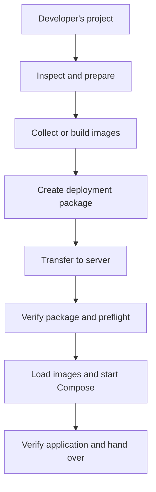
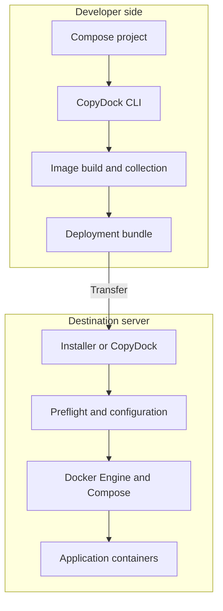
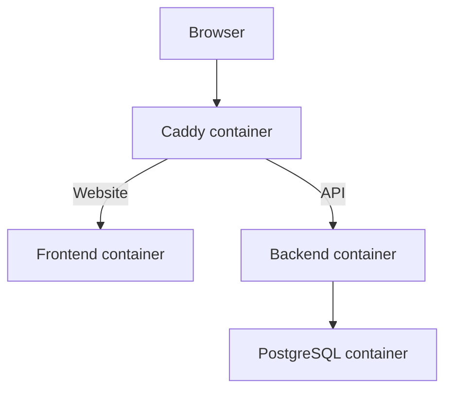

# CopyDock — Project Brief for a Building Agent

> Working concept and discussion document. CopyDock has not been built; names, commands, architecture, and priorities below are proposals unless identified as a requirement. The name “CopyDock” is the current working name; verify naming and package availability before release.

## 1. The idea in plain English

CopyDock is a proposed developer tool that turns a Docker Compose application into a portable deployment bundle. A developer prepares the bundle on a machine with the necessary images and build tools; then the bundle is transferred to a client's server or VPS, where the application can be installed and started, including in an offline environment.

The core outcome: **a repeatable, inspectable way to hand over and run a complete multi-container application**, without manually recreating every deployment step or pulling images on the destination server.

The target user is a developer deploying software to clients who want to operate it on their own server, retain control of their data, or run within a local network that may have no internet.

### Concrete example: SafeRx Hub

SafeRx might have a frontend, Django API, PostgreSQL database, background workers and Caddy. CopyDock would package the relevant images and deployment configuration so a client can run the app on their own server. Users could access it from computers on the client's network via an IP address or a properly configured subdomain.

Some features can still depend on internet: for example, Nalo SMS calls will fail while the server is offline. Packaging an application does not make external integrations work offline; the app should handle and communicate those failures appropriately.

## 2. Problems it solves

- Deployment handovers often require several manual steps: building, collecting images, copying files, configuring Compose, preparing environment variables and starting services.
- An offline destination cannot pull missing images from a registry.
- A developer needs confidence that the destination is compatible before changing it.
- The client should have a clear way to run and operate the app while retaining control over their data.
- A VPS deployment and a local server deployment should share a familiar workflow where practical.

CopyDock coordinates existing container tools; Docker itself remains responsible for running containers.

## 3. Scope and non-goals

### Desired capabilities

1. Inspect a Docker Compose project and determine its deployment requirements.
2. Build or collect all required images while network access is available.
3. Create a transferable package containing images, an installation-ready Compose definition, configuration templates and a manifest.
4. Transfer the package using a transport appropriate to the environment: USB drive, SCP, or another mechanism.
5. Run checks on a Linux destination before installation.
6. Load images and start the application without relying on a registry.
7. Provide clear status and useful error messages.
8. Support a reverse proxy such as Caddy as an application service, or integration with an existing proxy.

### Boundaries

- It is not a replacement for Docker, Compose, application code, DNS infrastructure, database administration or a backup system.
- It should not imply that all containers run on all hardware or that all applications automatically work offline.
- Offline installation assumes the destination already has compatible Docker Engine and Docker Compose, unless a separate, explicit offline prerequisite provisioning mechanism is designed. The package should check for them rather than silently downloading or installing them.
- A packaged application does not automatically migrate an existing database, include its data, configure DNS, open firewalls, or receive trusted TLS certificates. These need explicit workflows and operator decisions.
- Running containers with access to the Docker daemon grants powerful host-level capabilities; explain privileges and avoid unnecessary elevated operations.

## 4. End-to-end flow



### On the developer's machine

1. Install the CopyDock CLI.
2. Point it at the project and choose the Compose file and intended platforms where needed.
3. Check that referenced service images, configuration files and build inputs are present.
4. Build local images and/or obtain the needed image variants while online, as required.
5. Render an installation-ready deployment configuration and build a package.
6. Produce a manifest with enough detail to inspect and verify the bundle.

### Transfer

Copy the package with a USB drive, SCP, an internal file share, or another suitable transport. SCP requires network reachability to the destination, not necessarily public internet.

### On the destination

1. Verify package integrity and confirm provenance by a trusted channel.
2. Run preflight checks and resolve failures.
3. Provide destination-specific configuration and secrets locally.
4. Load the included container images.
5. Start the app using Compose with pulling and rebuilding disabled for the offline path.
6. Check container health and application availability, then provide operational instructions.

The exact invocation and whether the destination installer itself requires Python, is packaged as a binary, or is a small shell/bootstrap script are **open design decisions**. Do not assume a PyPI installation is available on an offline destination.

## 5. Distribution and installation

The user likes the idea of publishing CopyDock to PyPI. The intended developer experience could be:

```bash
pipx install copydock
```

Alternatively:

```bash
python -m pip install copydock
```

These commands are illustrative; publication and name availability are not established. `pipx` installs CLI applications in an isolated environment; a `pip` installation may be suitable within a virtual environment. Both require Python and the chosen installer to be present; accessing PyPI generally requires connectivity unless packages are made available locally.

GitHub can host the source code, documentation, issues and release workflow; PyPI distributes the published Python package. Simply putting code on GitHub does not automatically publish it to PyPI. Releases require packaging metadata, a build and a publishing process.

Separate questions for the building agent:

- Does the destination run a self-contained installer included in the deployment bundle, or install CopyDock separately?
- How are supported operating systems, Python versions and distribution artifacts defined?
- How will PyPI releases, provenance, versioning and upgrades be handled?
- Is `copydock` actually available as a package and command name?

## 6. Proposed stack, not a final decision

The preference is a **Python-first CLI**, not an insistence that every component be pure Python. Python fits the user's experience and PyPI distribution goal.

| Part | Candidate | Purpose |
| --- | --- | --- |
| Developer CLI | Python | Orchestration, configuration, diagnostics |
| Command interface | Typer or Click | Commands, arguments and help; select after evaluating dependencies and compatibility |
| Terminal presentation | Rich | Optional readable tables, progress and errors |
| Models and validation | Pydantic or standard library | Validate manifests and settings; choose based on complexity |
| External operations | Docker Engine and Compose CLI | Build, inspect, load and run images |
| Project packaging | `pyproject.toml` and a Python build backend | Build and publish the CLI |
| Tests | pytest and integration environments | Validate real packaging and offline deployment |
| Reverse proxy | Caddy container, optionally an existing proxy | Web routing and, where configured, TLS |
| App deployment description | Compose YAML | Defines services, networks, volumes and settings |

A Python tool can call the Docker/Compose CLI, or use APIs where justified. Investigate trade-offs around Compose features, output parsing, platform support, subprocess safety and testability before committing. Do not require Docker SDK or any particular library without a reason.

## 7. Architecture: developer tool and destination



### Developer side responsibilities

- Detect Compose files and resolve the intended project configuration.
- Identify images, build contexts, bind-mounted files, required variables, ports, volumes and selected platforms.
- Build or collect images and save them in a supported portable format.
- Distinguish deployment configuration from source code, secrets, generated build files and client data.
- Build a manifest, include checksums, provide helpful output and fail clearly when resources are missing.

### Destination side responsibilities

- Verify package checksums and, if implemented, a trusted signature.
- Check architecture, OS, Docker/Compose availability, disk space, ports and necessary permissions.
- Obtain or validate destination-specific configuration and secrets without embedding production secrets in the package.
- Load the images and launch Compose using only the included image versions.
- Report start-up failures and health results without leaking secrets.
- Preserve named volumes and application data across normal restarts and updates.

## 8. Illustrative commands

These are **ideas for discussion, not existing functionality or final syntax**:

```bash
# Inspect a project
copydock inspect ./saferx

# Package using an explicitly chosen Compose file
copydock package ./saferx --compose compose.yaml

# Optionally choose both supported CPU architectures
copydock package ./saferx --platform linux/amd64,linux/arm64

# Inspect a bundle
copydock inspect ./saferx-1.0.copydock

# Destination-side ideas; actual installer and syntax remain undecided
copydock preflight ./saferx-1.0.copydock
copydock install ./saferx-1.0.copydock
copydock status
```

If the destination does not have CopyDock or Python, the above destination commands cannot run by magic. The packaging and installation strategy must explicitly provide a compatible installer or make CopyDock an acknowledged prerequisite.

The default package command could use the current Docker environment's platform and clearly display it. It must not assume this matches a remote server. Potential alternatives include explicitly selecting a platform, inspecting a reachable destination, or offering a multi-platform package.

## 9. Architecture and portability

Docker packages an application and its user-space dependencies, making its environment consistent. Its binaries still need to be compatible with the destination's processor architecture and runtime environment.

- `linux/amd64`: common Linux servers running Intel/AMD 64-bit processors.
- `linux/arm64`: ARM64 Linux machines and many ARM VPS instances.
- `linux/amd64` is a platform category, not a specific computer.
- Foreign architectures can sometimes work with emulation, but support, speed and behavior vary. Do not treat emulation as guaranteed.
- A multi-platform image refers to multiple variants. Docker may select a compatible variant when pulling from a registry. For an offline bundle, CopyDock must explicitly collect the variants it needs; an image name alone does not guarantee that all variants are in the local image store or archive.
- Every needed service image, including databases and proxies, must support the destination platform. Installer binaries, if any, also require appropriate builds.
- Supporting multiple architectures will often increase bundle size. Image stores, archive behavior and Compose versions need compatibility testing.
- Windows or macOS development machines commonly run Linux containers through a Linux VM. A Linux server target still needs a compatible Linux container runtime.

Preferred product direction: avoid forcing every user to manually specify a platform, but always make the resulting target(s) visible and verify compatibility before installation.

## 10. Bundle contents and manifest

Illustrative only; actual archive structure is to be designed:

```text
saferx-package/
  manifest.json
  checksums.txt
  compose.yaml
  config/
    Caddyfile
    environment.example
  images/
    images.tar
  install/
    installer-or-instructions
  README.md
```

The manifest should consider package format version, application version, platforms, service-to-image mappings, immutable image identifiers or digests, required configuration, required ports, supported Docker/Compose versions, and file hashes. Decide how to represent per-platform variants and how to maintain backwards compatibility.

Checksums detect accidental changes but do not establish who created the package if an attacker can replace both the package and checksum. Authenticity requires a trusted signature or trusted channel; decide whether signing is in the MVP.

### Secrets and data

- Do not package production credentials, private keys, populated `.env` files or client databases by default.
- Provide configuration templates and collect secrets on the destination through an appropriate secure process.
- Do not place secrets in logs or shell history; validate permissions and avoid printing values.
- Explicitly identify required bind-mounted files. Avoid blindly copying arbitrary paths from the developer machine, and warn about files outside the project or suspected secrets.
- Container images can themselves contain accidentally baked-in secrets; excluding `.env` alone does not solve this.
- Named volumes hold persistent data; their contents do not automatically travel in Docker image archives. Backup, restore and data migration require a deliberate separate workflow and testing.

## 11. Reverse proxy: Caddy

The preferred default for a self-contained web deployment is to package Caddy as another Compose service alongside the application. CopyDock includes its image and required Caddyfile, so an offline server does not need to download or separately install Caddy.



A simplified Compose file:

```yaml
services:
  caddy:
    image: caddy:2
    ports:
      - "80:80"
    volumes:
      - ./Caddyfile:/etc/caddy/Caddyfile:ro
      - caddy_data:/data
      - caddy_config:/config
    restart: unless-stopped

  frontend:
    image: saferx-frontend:1.0
    restart: unless-stopped

  backend:
    image: saferx-backend:1.0
    restart: unless-stopped

  db:
    image: postgres:16
    volumes:
      - postgres_data:/var/lib/postgresql/data
    restart: unless-stopped
    # Real deployment needs database credentials and other settings.

volumes:
  caddy_data:
  caddy_config:
  postgres_data:
```

Example Caddyfile for HTTP on a local network:

```caddyfile
http://saferx.example.com {
    handle /api/* {
        reverse_proxy backend:8000
    }

    handle {
        reverse_proxy frontend:80
    }
}
```

This preserves the `/api/` prefix; verify it matches the backend's URL configuration. It assumes the frontend serves on port 80, the backend listens on port 8000, and both are reachable from Caddy over a shared Compose network. Configure Django's allowed hosts, CSRF and trusted proxy settings correctly for the actual deployment. The frontend should preferably use same-origin API requests or be configured appropriately at runtime.

The example omits production settings, health checks, database credentials, worker services and HTTP-to-HTTPS configuration. It is an architecture illustration, not a ready-to-run deployment. Pin and record exact image versions/digests in a real package; a mutable tag alone is not a reproducibility guarantee.

### Existing proxy

A client may already have Caddy, Nginx or another proxy bound to ports 80/443. Detect conflicts; do not replace or take over the existing service automatically. Provide a documented integration path or configurable alternative port. A shared proxy and separate Compose projects require an explicit networking and ownership design.

## 12. Local subdomains, DNS and TLS

A real subdomain can point to an application hosted on a local server. There are two distinct operations:

1. **DNS:** the user's device resolves the name to an IP address.
2. **Reverse proxy:** after the request reaches the server, Caddy uses the hostname and path to route it to a container.

For example, the organization's local DNS can map:

```text
saferx.example.com  ->  192.168.1.50
```

Computers using that DNS service can reach the local server by that name. Configure a stable address or DHCP reservation, and ensure client devices actually use the relevant local resolver. For a single-machine test, a hosts-file entry can work. A router may provide local DNS if it supports it. Local DNS should remain reachable during an internet outage.

Several names can resolve to the same server, and Caddy can route by hostname:

```caddyfile
http://saferx.example.com {
    reverse_proxy saferx-frontend:80
}

http://assets.example.com {
    reverse_proxy assettrack-frontend:80
}
```

This minimal two-app example shows hostname routing only; add each application's API routes separately. If services belong to different Compose projects, networking and DNS names must be set up appropriately.

### TLS options

| Environment | Approach | Conditions |
| --- | --- | --- |
| Local, offline | Internal CA, including Caddy's internal CA | Install and trust the issuing root CA on client devices; preserve CA data and protect its private key. Configure local DNS. |
| Local, server can access internet | Public certificate via DNS-01 challenge | Control the public domain DNS; use a compatible DNS provider integration, credentials and internet access for issuance/renewal. The app itself need not be publicly reachable. |
| Public VPS | Public certificate through Caddy's configured ACME validation | Public DNS and network access must meet the chosen challenge's requirements; HTTP/TLS challenges commonly require inbound access. |
| Internal demo | HTTP | Simple, but traffic is unencrypted; avoid treating it as suitable by default for sensitive production data. |

A public-domain hostname does not automatically make HTTPS certificates available offline. Standard public certificate issuance/renewal needs outside connectivity or a separately managed certificate; offline internal CA certificates require trust distribution. Caddy's DNS provider module may require a custom build, depending on the provider; don't assume the stock image contains it.

CopyDock should surface these prerequisites and help configure them; it cannot automatically control client DNS, certificate trust, the domain provider or firewall rules unless explicitly integrated and authorized.

## 13. Preflight checks

Potential checks before modifying the destination:

- Supported destination OS and architecture; package supports that platform.
- Required Docker Engine and Compose versions exist and the operator can access Docker.
- Enough storage for the archive, loaded image layers, containers and anticipated application data; report estimates as estimates.
- Ports are available, or the deployment is configured to use an existing proxy or alternative port.
- Required secrets, configuration and bind-mount files are present with suitable permissions.
- Package integrity and, if available, signature verification.
- Destination paths and volume names do not unexpectedly conflict with an existing deployment.
- Required network dependencies are reported, including external SMS or authentication services.
- Optional checks for configured hostname resolution and TLS readiness; these cannot prove every client can resolve or trust a certificate.

Separate non-destructive checks from actions. Fail with actionable messages; don't claim success merely because containers exist. Docker Compose startup order alone doesn't guarantee a service is ready; use health checks and explicit readiness behavior.

## 14. Deployment lifecycle and client handover

A successful handover includes more than starting containers:

- Explain how to access the application and what parts require internet.
- Document how to check status, logs, restart policy and available disk space.
- Agree who manages the host, Docker, domain, DNS, TLS certificates and backups.
- Establish database and uploaded-file backups, retention, off-server copies and tested restores.
- Keep production credentials and secrets under the client's control.
- Document upgrades, database migrations and recovery/rollback limitations. Application rollback may not reverse destructive database migrations; back up and test before upgrading.
- Consider versioning and compatibility checks for future update packages.
- Avoid deleting or overwriting persistent volumes on reinstall or uninstall by default.

These are product responsibilities and operational needs to decide and document; not all must be implemented in the first release.

## 15. MVP proposal

Start with a narrow, dependable end-to-end vertical slice:

1. Support a documented subset of Docker Compose applications and a Linux destination with preinstalled compatible Docker and Compose.
2. Package one explicitly selected platform, showing it clearly to the user. Consider multi-platform as a follow-on after the archive and runtime behavior are tested.
3. Include exact images, installation-ready Compose configuration, referenced allowed files, an environment template and a manifest with checksums.
4. Provide a clear destination installation mechanism that works offline under documented prerequisites.
5. Perform architecture, prerequisites, disk, port and required-configuration checks.
6. Load images and start without builds or pulls; verify a sample app responds.
7. Demonstrate with a sample frontend/backend/database/proxy application and exercise the process in an isolated offline test.

A later release can add multi-architecture bundles, remote SSH workflows, reusable proxy integration templates, package signatures, upgrade tooling and richer diagnostics. Inclusion order should follow user feedback and practical implementation complexity.

### MVP acceptance scenarios

- Build a bundle online, copy it to a clean Linux target with required runtime already installed, disconnect external network access, install and verify the application responds.
- Missing image, unsupported architecture, missing Docker/Compose, insufficient disk and occupied port produce actionable preflight failures.
- No implicit image pull or build occurs at the destination; the test must detect unintended external access.
- User-created persistent data survives restart and reinstall according to the documented behavior.
- Configuration containing a production secret is not bundled by default, and logs do not expose it.
- A browser on the test network reaches the app through the proxy using a configured name or IP; DNS and TLS setup are verified separately where applicable.

## 16. Questions for the building agent

1. How should the bundle format represent images, manifests, configuration and platform variants? What storage drivers and Docker/Compose versions will we support?
2. How can we reliably discover required Compose files, interpolation variables, profiles, extensions, bind mounts, build contexts and external networks/volumes without treating unsupported cases as supported?
3. Should destination installation use a Python CLI, an executable, a shell bootstrap, or a combination? How do we support offline installation and multiple architectures safely?
4. How should image collection handle `build:`, registry images, exact digests, multi-stage builds, and dependencies that are available for only one platform?
5. What is the cleanest way to create an offline Compose configuration that does not rebuild or pull and still resolves images reliably?
6. Which preflight checks can be guaranteed and which are advisory? What happens when the host already runs an application with the same project name or ports?
7. How do we handle generated configuration, Django environment values, sensitive settings and certificate keys without exposing secrets?
8. How should Caddy integrate with existing proxies or multiple deployments on one host?
9. How do we test complete installations under real offline conditions and ensure volumes are preserved?
10. How should future upgrades, database migrations, backups, signatures and rollback be designed without overloading the MVP?
11. Is the CopyDock name available on PyPI and as a CLI name, and does it conflict with existing projects?

## 17. Reference documentation

- Docker multi-platform images: https://docs.docker.com/build/building/multi-platform/
- Docker image save and platform variants: https://docs.docker.com/reference/cli/docker/image/save/
- Docker Compose networking: https://docs.docker.com/compose/how-tos/networking/
- Caddy automatic HTTPS: https://caddyserver.com/docs/automatic-https
- Caddy reverse proxy: https://caddyserver.com/docs/quick-starts/reverse-proxy
- Caddy DNS challenge configuration: https://caddyserver.com/docs/caddyfile/directives/tls

---

**Instruction to the building agent:** Treat this as a shared product brief, not an implemented specification. Challenge assumptions, identify missing requirements and edge cases, propose a staged implementation, and discuss consequential choices before treating proposed commands or behaviors as final.
